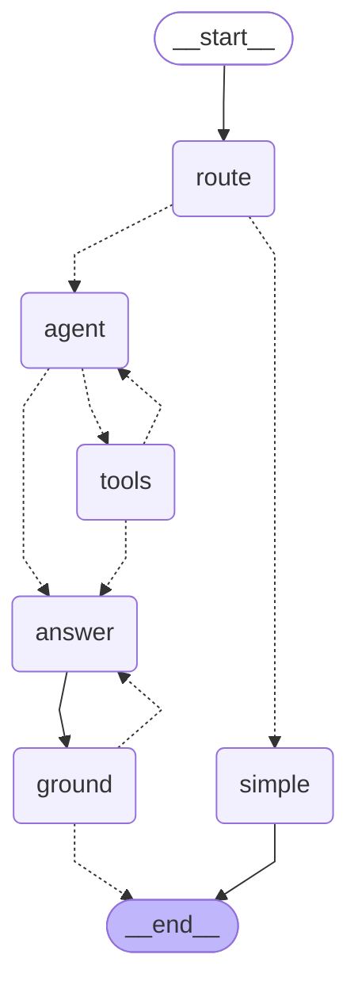

# ClinicalRAG

A clinical document question answering system. Upload clinical reports (typed, scanned, or handwritten), ask questions in plain English, and get answers grounded in the actual source documents. Every claim is traceable to a specific passage, and clicking a citation opens the actual PDF page with the cited text highlighted.

Built as a personal project to explore real-world RAG engineering: hybrid retrieval, real OCR tested against genuine scanned and handwritten datasets instead of synthetic stand-ins, and retrieval/generation quality measured with RAGAS rather than assumed.

## What it does

- Ask a question, get a grounded answer. Every answer cites the source file, section, and page it came from. Clicking a citation shows the actual PDF page with the cited text highlighted.
- Upload your own PDFs. Typed reports extract instantly through PyMuPDF; scanned or photographed documents fall back to OCR through docTR.
- Handles messy real-world documents, not just clean synthetic ones. See "Real-data testing" below.
- Refuses to guess. If the answer isn't in the documents, it says so instead of inventing a lab value or diagnosis.

## Architecture

```
PDF/image upload
      │
      ▼
┌─────────────┐   text layer present?  ┌──────────────────┐
│  PyMuPDF     │ ─────── no ──────────▶│  docTR OCR        │
│  extraction  │                       │  (detect + read)  │
└──────┬───────┘                       └─────────┬─────────┘
       │                          low page confidence?
       │                                          │ yes
       │                                          ▼
       │                              ┌────────────────────────┐
       │                              │ fine-tuned TrOCR        │
       │                              │ (handwriting specialist)│
       │                              └────────────┬────────────┘
       ▼                                            ▼
                  section-aware chunking
                            │
                            ▼
          contextual chunks (one LLM-written line of context each)
                            │
                            ▼
              BAAI/bge-small-en embeddings → ChromaDB
                            │
              ┌─────────────┴───────────────┐
              │   hybrid retrieval            │
              │   BM25 + dense + RRF fusion   │
              │   → cross-encoder rerank (20) │
              │   → parent-document expand    │
              └─────────────┬─────────────────┘
                            ▼
              Groq (gpt-oss-120b) → cited, grounded answer
```

### Retrieval robustness

A few things got added after real testing surfaced real gaps:

- Query rewriting. Typos like "whats the id of lymphoma patien" used to silently break retrieval. A fast LLM pass now normalizes the query before search.
- Parent-document expansion. A question needing two sections of the same report (for example "what medications is the lymphoma patient on?", where the diagnosis and the medication list live in different chunks) pulls in the right document's full context, not just the single top-scoring chunk.
- Contextual retrieval. Section chunks often don't say whose report they come from (a lab table is just numbers), so "what is the lymphoma patient's ID?" used to pull up other patients' ID sections. Each chunk now gets a short context line written once by an LLM ("Discharge summary for a 67-year-old male with...") that is indexed with it, following [Anthropic's technique](https://www.anthropic.com/news/contextual-retrieval). The context is only used for search; the answer model and the user only ever see the original document text.
- Wider rerank pool. The cross-encoder now re-scores the top 20 fused candidates instead of 5. Running it with batch size 1 kept that affordable: padding every pair in a batch to the longest one was most of the cost.
- Conversational messages like "thanks!" get a natural reply instead of a forced "not found in documents."

## How the agent works

Agent mode (the toggle under the question box) runs a LangGraph state machine instead of the single-pass pipeline. Dashed arrows are decisions made at run time:



`route` sends one-document questions to the normal pipeline (`simple`) and everything else to `agent`. The agent loops with `tools` (search, list documents, read a section) until it has enough or hits a limit of 6 tool calls. `answer` then writes from the gathered passages only, and `ground` checks that every citation points at one of them, asking for one rewrite if not.

In the app, agent mode draws this graph live and lights up each node as it runs. `scripts/draw_agent_graph.py` regenerates the diagram above, `scripts/visualize_agent_run.py` draws the path a single question took (example: [docs/runs/mh-creatinine-above-2.md](docs/runs/mh-creatinine-above-2.md)), and setting `CLINICALRAG_TRACING=phoenix` sends every LLM and tool call to a local [Arize Phoenix](https://github.com/Arize-ai/phoenix) with timings and token counts.

## Real-data testing

Everything below was measured against real external datasets, not synthetic test cases.

| Test | Dataset | Result |
|---|---|---|
| OCR, printed/scanned text | FUNSD (real scanned forms) | 90.7% word-level recall |
| OCR, handwritten text (baseline) | RxHandBD (real handwritten prescriptions) | 0% exact match. A genuine, documented hard-OCR-problem finding. |
| OCR, handwritten, fine-tuned model | RxHandBD (held-out test set) | 47.5% exact match after fine-tuning TrOCR on real labeled data |
| OCR, handwritten, generalization check | IAM (general handwriting) | Confirmed a real trade-off: fine-tuning for medical vocabulary cost general-handwriting accuracy, dropping from 53.8% to 7.7%. Documented, not hidden. |

The handwriting-recognition fine-tuning (`notebooks/finetune_trocr_rxhandbd.ipynb`) and the full generalization analysis are part of this repo, including the negative result, because that's the actually useful finding.

## Data

37 real clinical documents: 10 synthetic (LLM-generated, for controlled testing) plus 27 real, de-identified transcriptions from MTSamples across 9 medical specialties. Real dictated notes use a completely different section-header format than synthetic reports, so the chunker (`src/chunking/chunker.py`) handles both.

## Evaluation

[`eval/questions.json`](eval/questions.json) has 48 questions written from the source documents: single lookups, questions whose answer sits in a different section from the patient's identity, typo'd twins of clean questions, real MTSamples notes, multi-document questions, and 4 questions whose answer is in no document at all. Each has the gold sections and the key facts a correct answer must contain, and `scripts/check_eval_set.py` checks that every key fact really appears in its gold text.

Two layers of metrics:

- Retrieval and answer checks that need no LLM judge (`scripts/eval_retrieval.py`, `scripts/evaluate.py`): hit@k, MRR, gold-section recall, key-fact recall, correct refusals, false refusals. Cheap and repeatable, so every experiment was compared on these.
- RAGAS (faithfulness, context precision/recall, answer relevancy) with Gemini as the judge, kept separate from the Groq model that writes the answers.

### Retrieval (44 answerable questions)

| | hit@1 | hit@3 | MRR | gold-section recall | multi-doc section recall |
|---|---|---|---|---|---|
| Before | 0.932 | 0.932 | 0.932 | 0.862 | 0.660 |
| After (contextual + rerank pool 20) | **0.977** | **1.000** | **0.985** | **0.920** | **0.750** |

Five questions improved and none got worse. About 20 configurations were tried; the full table, per-question changes and latency are in [`eval/results/retrieval_experiments.md`](eval/results/retrieval_experiments.md). Two results worth knowing:

- The biomedical models did not help here. MedCPT (embedder and reranker, trained on PubMed search logs) and bge-reranker-base were equal or worse than the small general models on these notes, and 5-30x slower on CPU. The hard cases were about *which patient* a section belongs to, not medical vocabulary.
- Contextual chunks and the wider pool each broke one question on their own and fixed each other's miss when combined.

### Answers (48 questions, gpt-oss-120b)

| | key-fact recall | all facts present | multi-doc: recall / all facts | false refusals | unanswerable refused |
|---|---|---|---|---|---|
| Before | 0.843 | 0.773 | 0.674 / 0.417 | 6.8% | 4 / 4 |
| After | **0.924** | **0.864** | **0.806 / 0.583** | **0%** | 4 / 4 |

### Agent vs pipeline (12 multi-document questions)

| | key-fact recall | all facts present | better / worse than pipeline | median time |
|---|---|---|---|---|
| Pipeline | 0.806 | 0.583 | | 7 s |
| Agent | **0.972** | **0.917** | 4 / 0 | 50 s |

The agent wins where one search can't reach every report the answer needs (comparing patients, listing all patients with a finding). It costs 6-12 LLM calls instead of 2, and the times above include waits for Groq's free-tier rate limit. On 6 single-document questions the router sent all 6 to the normal pipeline, so they kept its speed and answers.

RAGAS (Gemini 3.1 Flash-Lite as judge) on the answerable questions:

| | faithfulness | context precision | context recall | answer relevancy |
|---|---|---|---|---|
| Before (39 scored before the judge quota ran out) | 0.843 | 0.590 | 0.821 | 0.904 |
| After (44) | 0.748 | 0.575 | 0.818 | 0.929 |

Faithfulness going down while correctness went up looked wrong, so I read the cases. Of the 7 "after" answers scored below 0.5, 5 are fully correct, with the cited fact sitting in the retrieved passage. One example is the lymphoma patient's ID, which the judge scored 0.0. Meanwhile the baseline got 1.0 for a wrong "not found" refusal (a refusal makes no claims to check) and for a medication list taken from the wrong patient's report (faithful to the wrong passages). Faithfulness measures consistency with what was retrieved, not correctness, and a small judge model makes outright mistakes. So the key-fact metrics are the ones used to make decisions here, with RAGAS as a secondary signal.

48 questions is enough to catch regressions, not to claim small differences: one question moves these numbers by 2-3 points, so per-question changes are reported alongside the means.

## Stack

| Layer | Choice |
|---|---|
| Backend | FastAPI |
| Frontend | Vanilla HTML/CSS/JS (ES modules), PDF.js for citation rendering |
| LLM | Groq, openai/gpt-oss-120b (also used for query rewriting) |
| Agent | LangGraph (router, tool loop, citation check) |
| Embeddings | BAAI/bge-small-en, contextual chunks written by gpt-oss-20b |
| Reranker | cross-encoder/ms-marco-MiniLM-L-6-v2 |
| Vector store | ChromaDB |
| OCR | PyMuPDF (text PDFs), docTR (scanned/image), fine-tuned TrOCR (handwriting) |
| Eval | Own 48-question set, deterministic metrics + RAGAS (Gemini judge) |

## Running locally

```bash
python -m venv .venv
.venv\Scripts\Activate.ps1          # Windows
pip install -r requirements.txt
# create a .env file with GROQ_API_KEY=your-key-here

python scripts/run_pipeline.py      # chunk the source PDFs
python scripts/ingest.py            # embed + index into ChromaDB

uvicorn src.api.main:app --reload --port 8000
```

Then open `http://localhost:8000`.

## Running with Docker

The easiest way to run this project: no Python environment, no manual pipeline steps. Docker Compose builds the image, indexes the source documents, and starts the app in one command, persisting anything uploaded afterward in named volumes.

```bash
# create a .env file with GROQ_API_KEY=your-key-here
docker compose up -d --build
```

Then open `http://localhost:8010`.

To run the container directly instead of through Compose:

```bash
docker build -t clinicalrag .
docker run -p 7860:7860 -e GROQ_API_KEY=your-key-here clinicalrag
```

## Known limitations

- Handwriting OCR remains genuinely hard. See the real, measured numbers above rather than a claim that it "works."
- The corpus (37 documents) and eval set (48 questions, written by me rather than a clinician) are small. The numbers show the method works and was measured; they don't say how it behaves on a hospital's archive.
- Vector store is ChromaDB (local/embedded), which is the right size for this corpus. A larger deployment would move to a server-based store.
- Agent mode costs 6-12 LLM calls per multi-document question, so on Groq's free tier it is slow (15-60 s) and rate-limited.
- Uploaded documents are not persistent on the Hugging Face Space (its disk resets on restart); the bundled documents are part of the image.
- The fine-tuned handwriting model (1.3GB) isn't bundled in this repo or image. See `notebooks/finetune_trocr_rxhandbd.ipynb` to reproduce it.
