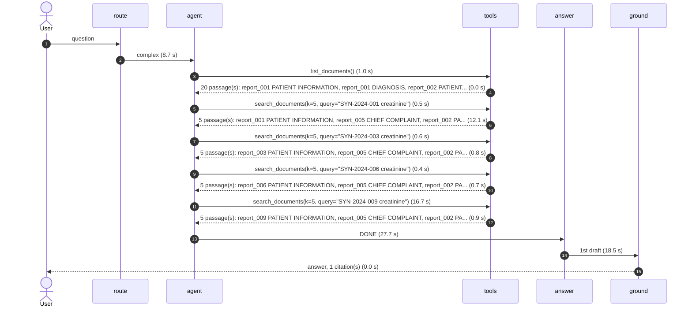

# Agent run: Which of the synthetic-report patients had a creatinine above 2.0 mg/dL, and what were the values?

Live run, 2026-10-09 05:20 UTC. route: **complex**, tool calls: **5**, model: `openai/gpt-oss-20b`, total: **88.6 s**.

Arrows are numbered in time order. `A->>T` is the agent asking for a tool call, `T-->>A` is what came back. Times in brackets are how long that step took, including any wait for a Groq rate limit and, on the first search, loading the embedding models.

## Tool calls in full

- agent asks for `list_documents()`
- `list_documents` returned: 20 passage(s): report_001 PATIENT INFORMATION, report_001 DIAGNOSIS, report_002 PATIENT INFORMATION, report_002 DIAGNOSIS, report_003 PATIENT INFORMATION (+15 more)
- agent asks for `search_documents(k=5, query="SYN-2024-001 creatinine")`
- `search_documents` returned: 5 passage(s): report_001 PATIENT INFORMATION, report_005 CHIEF COMPLAINT, report_002 PATIENT INFORMATION, report_005 PATIENT INFORMATION, report_002 FOLLOW-UP
- agent asks for `search_documents(k=5, query="SYN-2024-003 creatinine")`
- `search_documents` returned: 5 passage(s): report_003 PATIENT INFORMATION, report_005 CHIEF COMPLAINT, report_002 PATIENT INFORMATION, report_005 PATIENT INFORMATION, report_006 FOLLOW-UP
- agent asks for `search_documents(k=5, query="SYN-2024-006 creatinine")`
- `search_documents` returned: 5 passage(s): report_006 PATIENT INFORMATION, report_005 CHIEF COMPLAINT, report_002 PATIENT INFORMATION, report_005 PATIENT INFORMATION, report_006 FOLLOW-UP
- agent asks for `search_documents(k=5, query="SYN-2024-009 creatinine")`
- `search_documents` returned: 5 passage(s): report_009 PATIENT INFORMATION, report_005 CHIEF COMPLAINT, report_002 PATIENT INFORMATION, report_005 PATIENT INFORMATION, report_005 LABORATORY RESULTS

## Final answer

> The only synthetic‑report patient whose creatinine level exceeded 2.0 mg/dL is **Patient SYN‑2024‑005** (male, 76 years). 
> - **Creatinine:** 3.2 mg/dL (reported in the laboratory results section)[Source: report_005_renal_failure.pdf | LABORATORY RESULTS].

## Citations

1. `report_005_renal_failure.pdf` | LABORATORY RESULTS (page 1)
